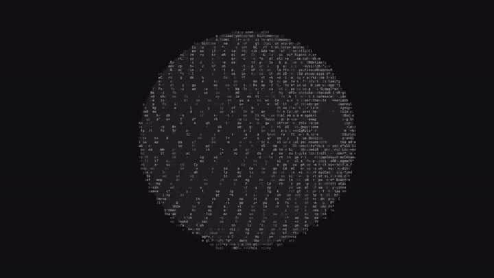
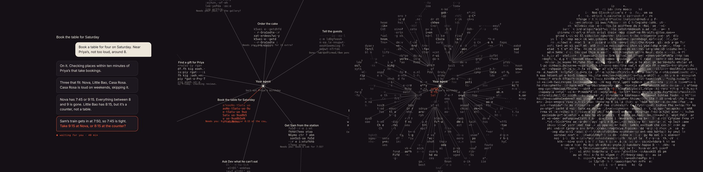

# One, ten, a thousand

You ask one AI agent for one thing, and a thousand agents end up doing the work. This is an interactive essay about what that looks like from your side of the screen, and about the one agent in the crowd that needs you.

[Open it live →](https://monalisachowdhury.vercel.app/one-ten-thousand/)

[](https://monalisachowdhury.vercel.app/one-ten-thousand/)

## The story

You type one request: *Sort out Priya's birthday on Saturday.* Your agent splits it into ten jobs (the table, the cake, the guests, a gift, getting Sam from the station), each job splits again, and by the end a thousand agents are working on one dinner.

Somewhere in there, the agent booking the table hits a decision only you can make: 9:15 at Nova, or 8:15 at the counter. Its question travels up through the agents above it and reaches you as one more notification in the pile. By the time you find it, the 9:15 is gone.

The piece asks you to find that agent yourself, and times how long it takes.



| Scale | What you see |
| --- | --- |
| One | A full conversation you can read, typing out as you scroll. |
| Ten | A title and the last line of each job, linked back to your agent. |
| A hundred | Text shrinks into texture. Motion shows working, blinking shows waiting, dim shows done. |
| A thousand | The whole crowd folds into a sphere you can drag around. Patterns replace conversations. |

Joel Lewenstein, Anthropic's head of product design, [said it plainly](https://www.ideo.com/journal/crafting-the-last-mile-of-delight): "we haven't invented an interface for managing hundreds or thousands of Claude instances." This piece sketches the problem that interface will have to solve.

## How it's built

Plain HTML, CSS and JavaScript, with no framework and no build step. A single `<canvas>` draws every agent, plain HTML handles the copy and the chat panel, and the page scroll drives everything.

### Every agent is made of its own words

The canvas is a grid of monospace character cells. Each agent fills a small block of cells shaped like a paragraph (the last line runs shorter), and the characters come from that agent's own title and last message. Zoomed in, you can almost read it. Zoomed out, it becomes texture.

### Three brightness bands, one draw call per row

Each cell keeps the brightest agent that touches it. Rows are then drawn as three strings at three opacities, plus one vermilion layer for the table agent. That keeps a thousand agents smooth on a laptop without WebGL.

### Status is motion

Working agents shuffle their characters, waiting agents pulse, finished agents dim. A legend never appears; the piece teaches the code in one sentence and then trusts you.

### A sunflower spiral with a family tree

Agents sit on a golden-angle spiral around your agent at the centre, so the first ten form an even ring and every later agent fills in around them. Each agent links to the nearest agent one level up, so the hierarchy reads as lines without being stored as a tree.

### Scroll is the zoom

Each scene maps its scroll progress onto a log scale, so moving from one to ten to a thousand feels like the same distance each time. The camera eases toward its target every frame, which keeps fast scrolling from feeling jumpy.

### The sphere

In the last scene, each agent's spiral position becomes a point on a sphere (distance from the centre turns into latitude), rotated by drag and a slow idle spin, with depth fading the far side.

### Finding it

In the "look around" scene the vermilion highlight switches off, so the table agent looks like everyone else. You zoom with a slider, pinch, or ctrl/⌘ + scroll, hover to read and click to open. Find it and the page tells you how long you took against how long it has been waiting.

## Details that matter

- Normal scrolling always scrolls. The canvas only takes over the wheel when you hold ctrl/⌘, so the copy never gets stuck.
- On phones the copy moves into a panel at the bottom and the agents stay in view above it.
- With reduced motion turned on, typing, pulsing and shuffling stop and the camera jumps instead of easing.
- The ten jobs your agent hands out have full conversations written for them. The other 990 get a title, a status and a last line, assembled from a small set of parts.

## Run it locally

```
git clone https://github.com/monalisachowdhury23-bit/one-ten-thousand.git
cd one-ten-thousand
python3 -m http.server 8000
```

Then open http://localhost:8000. You can also open `index.html` straight from the folder.

## Files

```
index.html        the copy, scenes and chat panel
style.css         layout, type and the phone layout
script.js         the canvas renderer, scroll logic, sphere and the find-it game
media/            images for this README
```

Made by [Monalisa Chowdhury](https://monalisachowdhury.vercel.app/).
